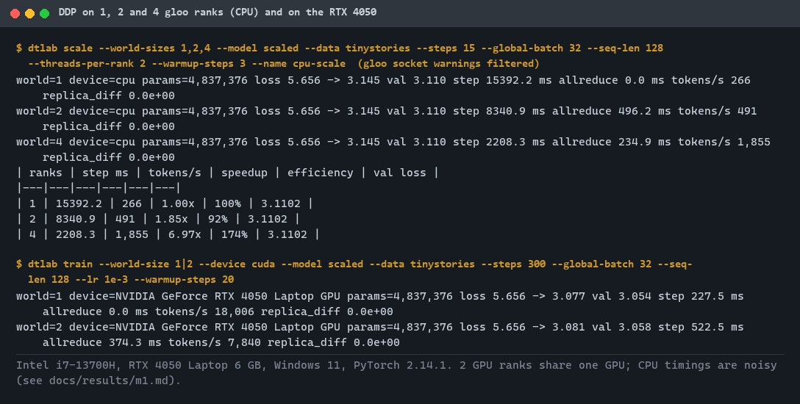
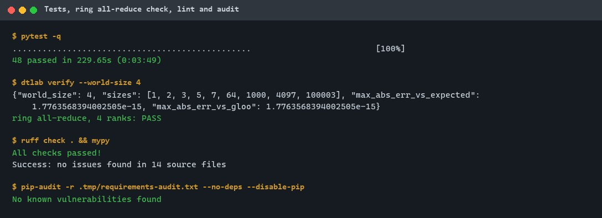
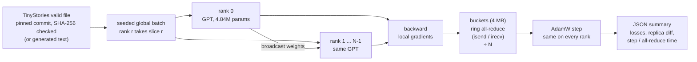
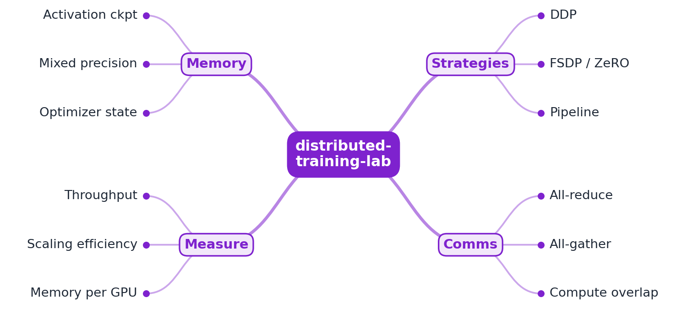
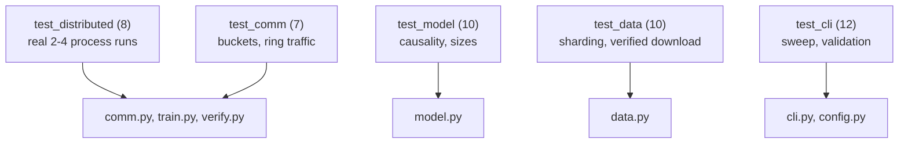

# distributed-training-lab

[](https://github.com/EquinoxWN/distributed-training-lab/actions/workflows/ci.yml)


> Train a model across several devices and see what each strategy costs. M1: data parallelism (DDP) with a hand-written ring all-reduce, checked against one process and against PyTorch DDP on 1, 2 and 4 ranks.

Part of my **AI and Machine Learning** list · Python

> Builds on: [tiny-transformer-scratch](https://github.com/EquinoxWN/tiny-transformer-scratch)

## Proof it works

A 4.84M-parameter version of the tiny-transformer-scratch model trains on the TinyStories file with 1, 2 and 4 gloo ranks on the CPU and reaches the same losses at every world size (held-out loss 3.1102), with replicas that differ by exactly 0. The same model trains on the RTX 4050 (18,006 tokens/s), and with 2 ranks sharing that GPU:



48 tests pass (including real 2-, 3- and 4-process runs), the ring all-reduce matches the expected sum on 4 ranks, lint and types are clean, and the dependency audit finds nothing:



## Architecture

**What M1 runs today:**



**Full roadmap (M1 to M3):**



## How it works

_Steps 1 and 2 are built and tested (M1); the rest is on the [roadmap](#roadmap)._

1. A scaled-up version of tiny-transformer-scratch is trained on 1, 2 and 4 GPUs.
2. DDP replicates the model and averages gradients with all-reduce.
3. FSDP shards parameters, gradients and optimizer state (ZeRO-style), so larger models fit per GPU.
4. Pipeline parallelism splits layers across GPUs and uses micro-batches to reduce idle time.
5. Activation checkpointing and mixed precision trade compute for memory.
6. The profiler separates communication from compute, and scaling efficiency is reported per strategy.

In M1, "1, 2 and 4 GPUs" means 1, 2 and 4 separate processes in a gloo process group on the CPU, plus a 1-rank run on the one RTX 4050 and 2 ranks sharing it ([ADR 0003](docs/adr/0003-gloo-cpu-ranks-stand-in-for-multiple-gpus.md)). The model is the tiny-transformer-scratch architecture in PyTorch (causal multi-head attention, GELU MLP, pre-LayerNorm, tied output head): `tiny` (125K parameters) and `scaled` (4.84M). DDP is hand-written ([ADR 0002](docs/adr/0002-hand-written-ring-all-reduce-checked-against-pytorch-ddp.md)): rank 0's weights are broadcast, each rank takes its slice of one seeded global batch, gradients are bucketed and summed with a ring all-reduce built on `isend`/`irecv`, then divided by the number of ranks.

## Who it helps

- **Who:** engineers and students who need to understand data-parallel training before paying for a multi-GPU node.
- **The problem:** DDP is usually used as a black box, so it is hard to see what is communicated, what it costs, and whether a distributed run still computes the same update as one device.
- **How to use it:** run `dtlab scale` on a laptop to train the same model on 1, 2 and 4 ranks and compare losses, replica equality, step time and all-reduce time; run `dtlab verify` to check the all-reduce; read `comm.py` (under 170 lines) for the ring algorithm and the bucketing.

## Tech stack

| Area | In M1 | Planned |
|---|---|---|
| Core | PyTorch 2.14, `torch.distributed` with gloo, hand-written DDP (bucketed ring all-reduce), PyTorch DDP as a reference | FSDP / ZeRO, pipeline parallelism (M2) |
| Compute | 1, 2 and 4 gloo processes on the CPU; one RTX 4050 Laptop GPU (CUDA 13.0) | 2 to 4 rented GPUs with NCCL |
| Measure | step, compute and all-reduce time, tokens/s, CUDA peak memory, JSON per run | PyTorch profiler, memory per strategy, charts (M3) |

Language: **Python** (3.11+, PyTorch). Code in [`src/distributed_training_lab/`](src/distributed_training_lab): `model.py` (GPT), `data.py` (verified download, batch sharding), `comm.py` (ring all-reduce, buckets, replica check), `train.py` (per-rank loop, launcher), `verify.py`, `cli.py`, `config.py` (validated settings).

## Run it

**Prerequisites:** Python 3.11+ and GNU make. Everything runs on a CPU; the GPU run needs an NVIDIA GPU and `make setup-gpu`.

```bash
python -m venv .venv && source .venv/bin/activate   # Windows: .venv\Scripts\activate
make setup      # PyTorch (CPU build) and dev tools
make lint       # ruff, ruff format, mypy --strict
make test       # 48 tests, about 4 minutes (starts real gloo process groups)
make verify     # ring all-reduce on 4 ranks against the expected sum and gloo
make scale      # download TinyStories (19 MB, verified), then 1, 2 and 4 CPU ranks
make gpu        # after make setup-gpu: 1 rank on the GPU, then 2 ranks sharing it
make audit      # pip-audit
```

Single runs: `dtlab train --world-size 4 --model scaled --steps 50`. Results go to `.tmp/runs/<name>.json`; no model files are written.

## Tests and results

Full numbers, method and analysis: [docs/results/m1.md](docs/results/m1.md).

| Test file | Tests | What it proves |
|---|---|---|
| `tests/test_distributed.py` | 8 | ring all-reduce = expected sum = gloo on 2, 3, 4 ranks; DDP on 2 and 4 ranks gives the same losses and weights as one process, replicas exactly equal although ranks start from different seeds; hand-written DDP = PyTorch DDP |
| `tests/test_cli.py` | 12 | `dtlab scale` end to end on 1 and 2 ranks, scaling math, output paths confined to `.tmp/runs`, invalid runs rejected |
| `tests/test_model.py` | 10 | shapes, causal mask, parameter counts of the presets, model-state bytes, loss decreases, invalid shapes rejected |
| `tests/test_data.py` | 10 | rank slices rebuild the single-process batch exactly; download accepted only with the pinned size and SHA-256 over HTTPS |
| `tests/test_comm.py` | 7 | buckets cover every parameter once within the cap; ring traffic is 2 (N-1)/N of the payload |
| `tests/test_smoke.py` | 1 | package imports |

| Check | Result |
|---|---|
| Tests (`make test`) | **48 passed**, 0 failed |
| Ring all-reduce, 4 ranks, sizes 1 to 100,003 | max error 1.8e-15 (float64): PASS |
| `scaled` model, 1 / 2 / 4 CPU ranks, 15 steps | identical losses (5.656 to 3.145, held-out 3.1102), replica difference 0 |
| All-reduce of 19.3 MB of gradients per step (6 buckets) | 496 ms on 2 CPU ranks, 235 ms on 4 |
| CPU speedup at 4 ranks | 6.97x, which is **not** a scaling result: machine load and per-token cost changed with batch size (see the analysis in the results) |
| RTX 4050, 1 rank, 300 steps | 18,006 tokens/s, 514 MB CUDA peak, loss 5.656 to 3.077, held-out 3.054 |
| RTX 4050 shared by 2 ranks | replicas identical; 7,840 tokens/s (both ranks on one GPU) |
| Lint / audit | ruff and mypy `--strict` clean; `pip-audit`: no known vulnerabilities |

### Test map



## Roadmap

**M1** (≈8 h)
- [x] Write `docs/rfc/0001-design.md`: problem, goals, non-goals, chosen design
- [x] A scaled-up version of tiny-transformer-scratch is trained on 1, 2 and 4 GPUs (M1: 1, 2, 4 gloo CPU ranks and one GPU).
- [x] DDP replicates the model and averages gradients with all-reduce.

**M2** (≈8 h)
- [ ] FSDP shards parameters, gradients and optimizer state (ZeRO-style), so larger models fit per GPU.
- [ ] Pipeline parallelism splits layers across GPUs and uses micro-batches to reduce idle time.

**M3** (≈9 h)
- [ ] Activation checkpointing and mixed precision trade compute for memory.
- [ ] The profiler separates communication from compute, and scaling efficiency is reported per strategy.
- [ ] Publish the proof below with real numbers

## Proof

What this repo must show before it counts as done:

- Scaling-efficiency and memory-per-GPU charts for each strategy.

| Result | Value |
|---|---|
| M3 proof above | Not measured yet (M3). Current M1 numbers: see [Tests and results](#tests-and-results). |

## Why it matters

- **Interview angle:** 'How would you train a model that doesn't fit on one GPU?'
- **Upstream I'm contributing to:** PyTorch distributed, or Optuna (Preferred Networks) tuning integrations.

## Design docs

- [RFC 0001: design](docs/rfc/0001-design.md)
- [ADR 0001: record architecture decisions](docs/adr/0001-record-architecture-decisions.md)
- [ADR 0002: hand-written ring all-reduce, checked against PyTorch DDP](docs/adr/0002-hand-written-ring-all-reduce-checked-against-pytorch-ddp.md)
- [ADR 0003: gloo CPU ranks stand in for 2 and 4 GPUs](docs/adr/0003-gloo-cpu-ranks-stand-in-for-multiple-gpus.md)
- [M1 results](docs/results/m1.md)

## Scope

This is a learning and portfolio system, not a hosted production service. Everything runs locally. Multi-GPU and multi-node runs (NCCL) are not tested in M1.

## Security and contributing

- Every GitHub Action is pinned to a commit SHA; workflows run read-only, without persisted credentials.
- Dependabot update pull requests are paused (`open-pull-requests-limit: 0`) so the repository keeps a single `main` branch; dependencies are updated by hand and checked by the CI audit.
- The dataset is downloaded only over HTTPS, capped at its pinned size and refused unless its SHA-256 matches; the process group rendezvous uses 127.0.0.1; run names cannot write outside `.tmp/runs`.
- Report vulnerabilities privately: see [SECURITY.md](SECURITY.md). To contribute, see [CONTRIBUTING.md](CONTRIBUTING.md).

## License

MIT, see [LICENSE](LICENSE).
